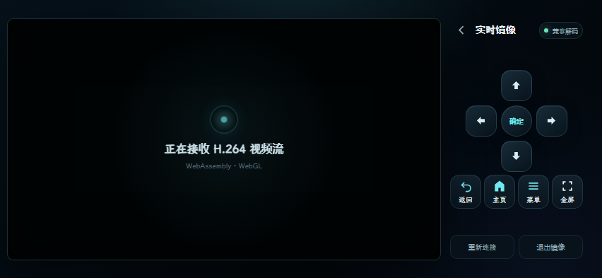

# N1 Pocket Remote

> [!IMPORTANT]
> **AI 构建声明：** 本项目由 AI 协助完成代码、界面、测试和文档。虽然已在真实斐讯 N1 上完成安装与运行验证，二次开发者仍应自行进行代码审计、安全评估和设备备份。

把 Android TV / 电视盒子变成可由手机直接接管的局域网控制台。项目专为斐讯 N1（Android 7.1、API 25）验证，也适用于其他已 root、带 ADB 的 Android TV 设备。

> 本仓库是非官方项目。请只在可信局域网中使用，不要把控制端口或 ADB 端口暴露到公网。

## 配套 N1 桌面

| 项目 | 作用 |
|---|---|
| [Aerial-TV-N1](https://github.com/jimmieyangcsjs/Aerial-TV-N1) | 推荐的默认桌面，首页和屏保显示本项目的动态登录二维码 |
| [CleanYourTV-N1](https://github.com/jimmieyangcsjs/CleanYourTV-N1) | 可回退桌面，保留早期 N1 桌面路径 |
| N1 Pocket Remote（本仓库） | 手机 Web/PWA 控制端、电视服务和同签名二维码状态 |

Aerial-TV-N1 与本项目 APK 必须使用同一套签名，桌面才能通过受限 `ContentProvider` 读取遥控状态。

<table>
  <tr>
    <td align="center"><br><sub>遥控与应用管理</sub></td>
    <td align="center"><br><sub>独立触控页</sub></td>
  </tr>
</table>

手机横屏镜像使用独立的右侧控制栏，TV 窗口留在左侧并保持最大显示：

<p align="center">
  
</p>

## 功能

- 电视上显示地址、动态 PIN 和自动登录二维码。
- 电视端大屏状态台使用矢量背景、玻璃卡片和高对比二维码，同时适配 1080p 与 4K 电视。
- 中文 PWA 手机控制台，可添加到主屏幕。
- 独立实时镜像页：官方 scrcpy 5.0.1、H.264 视频与直接触摸注入。
- 手机横屏时把标题、状态和全部控制按钮收纳到右侧，左侧 TV 画面独立最大化。
- HTTPS 环境使用 WebCodecs 硬件解码；普通局域网 HTTP 自动回退到内置 TinyH264 WebAssembly + WebGL。
- 方向键、OK、返回、主页、菜单、音量、静音。
- 可见虚拟指针触控页，按手机触控面积和电视分辨率换算速度。
- 触控点击、长按、滑动，以及点击/返回/菜单长按按钮。
- 应用列表、真实图标、启动、用户应用卸载。
- 手机上传 APK 并安装。
- 电视截图。
- 中文输入法桥接。
- 前台常驻、开机启动、网络恢复、服务自检与端口看门狗。
- 持久输入事件通道，常规按键延迟约 11–20 ms。
- 与同签名桌面通过受限 `ContentProvider` 共享二维码状态，不暴露匿名 PIN API。

## 目录

```text
app/                       Android 应用与服务
app/src/main/assets/web/   手机 Web/PWA
docs/                      安装、架构、API、字体说明
tools/                     本地 Mock 服务
dist/                      已签名测试 APK
```

## 快速开始

1. 安装 [dist/N1Remote-v0.1.1.apk](dist/N1Remote-v0.1.1.apk)。
2. 打开一次 N1 Remote，并允许 SuperSU 授权。
3. 保证盒子与手机在同一局域网。
4. 打开 `http://<盒子IP>:8088`，输入电视显示的动态 PIN，或直接扫描二维码。
5. 点击“实时镜像”进入独立手机镜像页。
6. 手机浏览器中选择“添加到主屏幕”。

升级已安装版本时使用 `adb install -r`，不要先卸载应用，以保留永久 root 授权和本地会话数据。

完整步骤见 [docs/INSTALL.md](docs/INSTALL.md)。

## 构建

需要 JDK 17、Android SDK 34：

```powershell
$env:JAVA_HOME="C:\path\to\jdk17"
$env:ANDROID_HOME="C:\path\to\android-sdk"
.\gradlew.bat assembleRelease
```

APK 输出到 `app/build/outputs/apk/release/`。

前端资源和布局检查：

```powershell
node --check app/src/main/assets/web/client-core.js
node --check app/src/main/assets/web/mirror.js
node --test tests/web-assets.test.js tests/client-core.test.js tests/android-tv-layout.test.js
```

Android 单元测试与完整构建：

```powershell
.\gradlew.bat test assembleRelease
```

## 技术设计

- `RemoteServer`：轻量 HTTP 服务、静态资源缓存、鉴权 API。
- `RemoteService`：前台服务、网络回调、端口监控和自动恢复。
- `InputDaemon`：持久化输入事件通道，避免每次按键启动 Android `input` 进程。
- `PointerOverlay`：不可触摸的电视端指针层。
- `ScrcpyMirror`：启动官方 scrcpy-server，代理视频并注入镜像触摸。
- `TinyH264`：非 HTTPS 局域网下的离线 WebAssembly 解码回退。
- `StatusProvider`：同签名权限保护的桌面状态读取。
- `BootReceiver`：开机、更新和网络变化恢复。

详见 [docs/ARCHITECTURE.md](docs/ARCHITECTURE.md) 和 [docs/API.md](docs/API.md)。

## 实时镜像

实时镜像是独立页面 `/mirror.html`，不占用普通遥控页的布局。镜像链路不向手机暴露 ADB `5555`，视频和触摸都经过现有 `8088` PIN 鉴权。

- 设备端采集与输入：官方 [scrcpy](https://github.com/Genymobile/scrcpy) server `5.0.1`。
- 视频：H.264 Baseline，最高 60 fps、约 8 Mbps；实际编码尺寸由 scrcpy 流元数据返回。
- 解码：安全上下文优先 WebCodecs；局域网 HTTP 使用内置 TinyH264 WebAssembly，并通过 WebGL 显示 YUV420 画面。
- 触控：在画面上点按、长按和滑动；提供返回、主页、菜单与全屏按钮。
- 单查看器：同一时间只允许一部手机占用镜像，关闭页面会释放编码器。

### 手机横屏布局

横屏规则不会把控制栏叠在视频画面上。页面使用两列布局：左侧为根据真实视频宽高比缩放的 TV 窗口，右侧为固定宽度控制栏。

- 右侧顶部：“实时镜像”和连接状态。
- 右侧中部：方向键、OK，以及返回、主页、菜单、全屏四个按钮。
- 右侧底部：重新连接、退出镜像。
- 四个快捷功能按钮至少保持 `44×44 px` 触控面积，避免横屏时互相挤压。
- 在小米 15 Pro 对应的 `852×393` CSS 视口中，左画面为 `614×342`，右栏为 `188 px`，页面无滚动或控件重叠。

斐讯 N1 实测只有 `OMX.amlogic.video.encoder.avc` 硬件编码器，因此镜像不能使用 H.265 硬件编码。H.264 是这台设备兼顾兼容性、功耗和延迟的正确选择。

非 HTTPS 场景的 WebAssembly 解码主要依赖手机 CPU；不同手机的实际帧率会不同。若设备支持局域网 HTTPS，可启用 WebCodecs 硬件解码路径。

## 1080p 与 4K 适配

- 手机镜像页跟随视频流元数据计算宽高比，不使用固定的 16:9 假设。全屏、旋转和浏览器地址栏高度变化后都会重新计算画面尺寸。
- 手机横屏时使用“左侧画面 + 右侧控制栏”的自适应网格，控制按钮不覆盖 TV 窗口；右侧标题、功能键和会话按钮分别占据顶部、中部和底部区域。
- 电视端 Android 资源按逻辑宽度选择：常见 1080p、240 dpi 电视命中 `w1280dp`；4K、320 dpi 电视命中 `w1920dp`。两套尺寸保持相同的版式层级，不依赖位图拉伸。
- 电视背景与图标使用矢量资源，在 1080p 和 4K 屏幕上保持清晰。
- 部分 Amlogic 编码器会将 1920×1080 的画面按 16 像素对齐为 1920×1072。镜像触摸始终使用当前视频流会话的真实尺寸，避免按钮位置偏移或被 scrcpy 丢弃。

## 安全

- PIN 由 SecureRandom 生成并保存在应用私有存储中。
- 状态 Provider 仅允许同签名 APK 读取。
- HTTP 控制台只适合可信家庭网络；外网访问请使用 Tailscale 等私有网络。
- 实时镜像始终通过 PIN 鉴权代理；不要另行开放或转发 ADB `5555`。
- 详见 [SECURITY.md](SECURITY.md)。

## 字体

手机固定界面使用 LXGW WenKai GB Screen 的 84 KB WOFF2 子集；动态应用名缺字时自动回退系统字体。字体按 SIL OFL 1.1 分发，许可证见 [app/src/main/assets/web/OFL-LXGW-WenKai-Screen.txt](app/src/main/assets/web/OFL-LXGW-WenKai-Screen.txt)。

## 许可证

N1 Remote 源码使用 MIT License，见 [LICENSE](LICENSE)。第三方组件和字体的许可见 [NOTICE.md](NOTICE.md)。

AI 构建与人工验证边界见 [AI-NOTICE.md](AI-NOTICE.md)。


