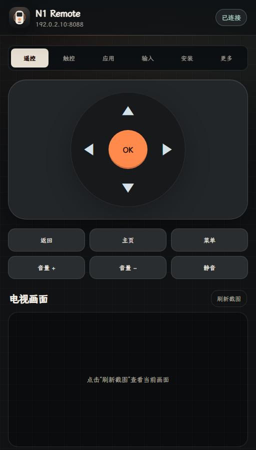
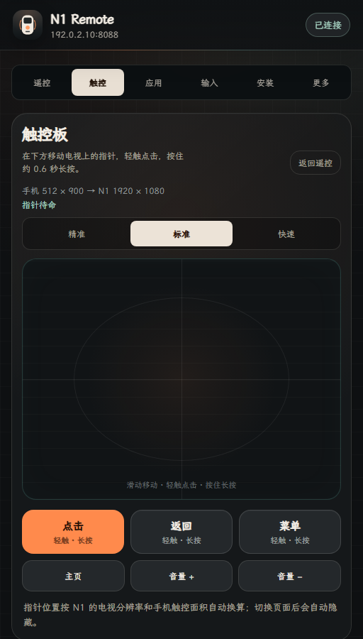

# N1 Pocket Remote

> [!IMPORTANT]
> **AI 构建声明：** 本项目由 AI 协助完成代码、界面、测试和文档。虽然已在真实斐讯 N1 上完成安装与运行验证，二次开发者仍应自行进行代码审计、安全评估和设备备份。

把 Android TV / 电视盒子变成可由手机直接接管的局域网控制台。项目专为斐讯 N1（Android 7.1、API 25）验证，也适用于其他已 root、带 ADB 的 Android TV 设备。

> 本仓库是非官方项目。请只在可信局域网中使用，不要把控制端口或 ADB 端口暴露到公网。

<table>
  <tr>
    <td align="center"><br><sub>遥控与应用管理</sub></td>
    <td align="center"><br><sub>独立触控页</sub></td>
  </tr>
</table>

## 功能

- 电视上显示地址、动态 PIN 和自动登录二维码。
- 中文 PWA 手机控制台，可添加到主屏幕。
- 方向键、OK、返回、主页、菜单、音量、静音。
- 可见虚拟指针触控页，按手机触控面积和电视分辨率换算速度。
- 触控点击、长按、滑动，以及点击/返回/菜单长按按钮。
- 应用列表、真实图标、启动、用户应用卸载。
- 手机上传 APK 并安装。
- 电视截图。
- 中文输入法桥接。
- 前台常驻、开机启动、网络恢复、服务自检与端口看门狗。
- 持久输入事件通道，常规按键延迟约 11–20 ms。
- 与同签名桌面通过受限 `ContentProvider` 共享二维码状态，不暴露匿名 PIN API。

## 目录

```text
app/                       Android 应用与服务
app/src/main/assets/web/   手机 Web/PWA
docs/                      安装、架构、API、字体说明
tools/                     本地 Mock 服务
dist/                      已签名测试 APK
```

## 快速开始

1. 安装 [dist/N1Remote-v0.1.apk](dist/N1Remote-v0.1.apk)。
2. 打开一次 N1 Remote，并允许 SuperSU 授权。
3. 保证盒子与手机在同一局域网。
4. 打开 `http://<盒子IP>:8088`，输入电视显示的动态 PIN，或直接扫描二维码。
5. 手机浏览器中选择“添加到主屏幕”。

完整步骤见 [docs/INSTALL.md](docs/INSTALL.md)。

## 构建

需要 JDK 17、Android SDK 34：

```powershell
$env:JAVA_HOME="C:\path\to\jdk17"
$env:ANDROID_HOME="C:\path\to\android-sdk"
.\gradlew.bat assembleRelease
```

APK 输出到 `app/build/outputs/apk/release/`。

## 技术设计

- `RemoteServer`：轻量 HTTP 服务、静态资源缓存、鉴权 API。
- `RemoteService`：前台服务、网络回调、端口监控和自动恢复。
- `InputDaemon`：持久化输入事件通道，避免每次按键启动 Android `input` 进程。
- `PointerOverlay`：不可触摸的电视端指针层。
- `StatusProvider`：同签名权限保护的桌面状态读取。
- `BootReceiver`：开机、更新和网络变化恢复。

详见 [docs/ARCHITECTURE.md](docs/ARCHITECTURE.md) 和 [docs/API.md](docs/API.md)。

## 安全

- PIN 由 SecureRandom 生成并保存在应用私有存储中。
- 状态 Provider 仅允许同签名 APK 读取。
- HTTP 控制台只适合可信家庭网络；外网访问请使用 Tailscale 等私有网络。
- 详见 [SECURITY.md](SECURITY.md)。

## 字体

手机固定界面使用 LXGW WenKai GB Screen 的 84 KB WOFF2 子集；动态应用名缺字时自动回退系统字体。字体按 SIL OFL 1.1 分发，许可证见 [app/src/main/assets/web/OFL-LXGW-WenKai-Screen.txt](app/src/main/assets/web/OFL-LXGW-WenKai-Screen.txt)。

## 许可证

N1 Remote 源码使用 MIT License，见 [LICENSE](LICENSE)。第三方组件和字体的许可见 [NOTICE.md](NOTICE.md)。

AI 构建与人工验证边界见 [AI-NOTICE.md](AI-NOTICE.md)。


